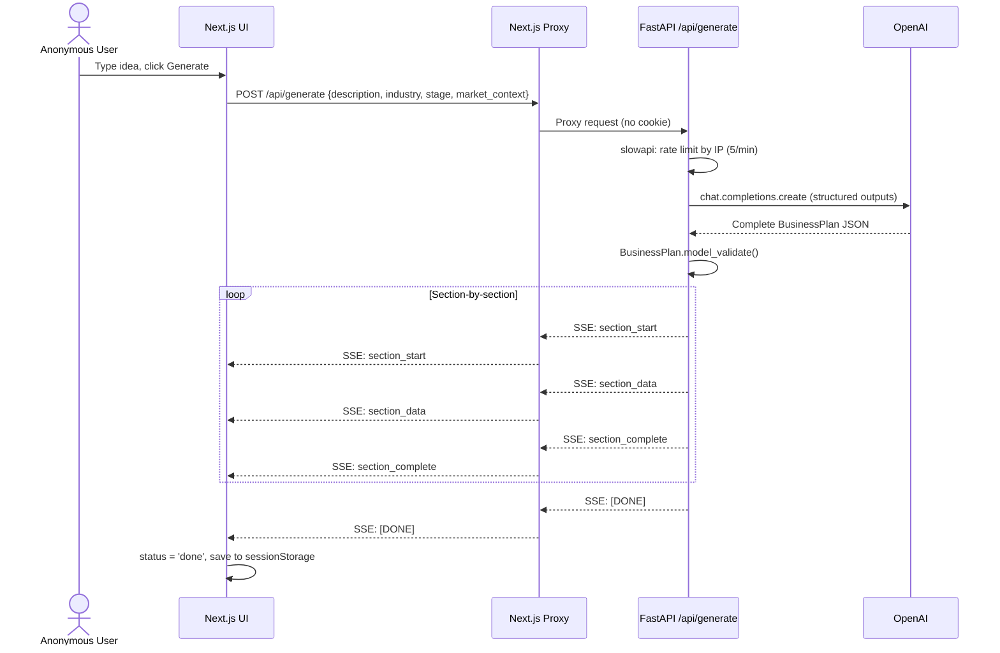
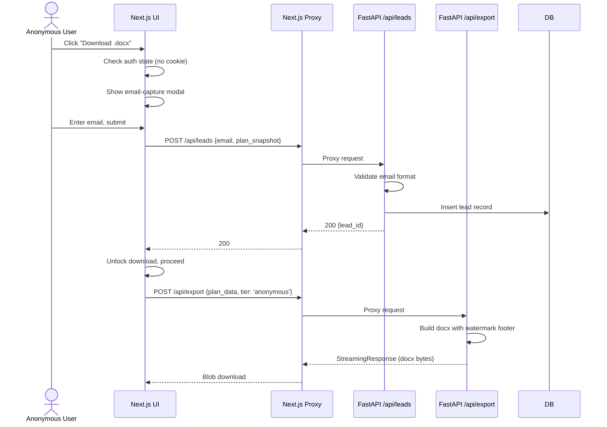
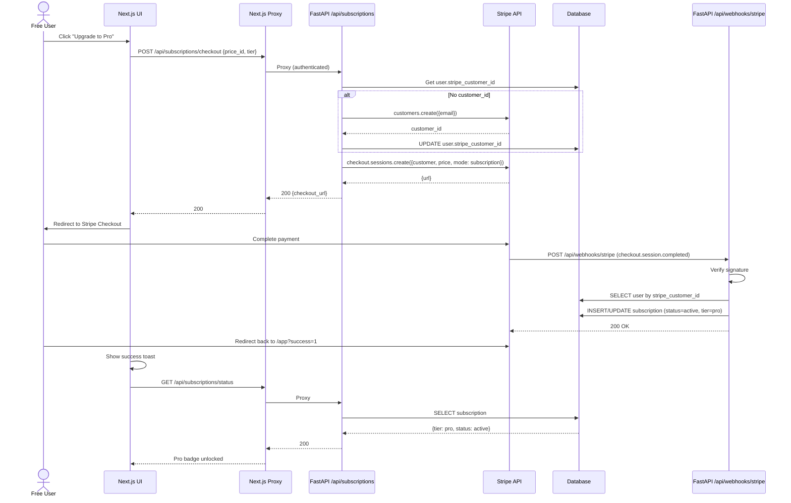
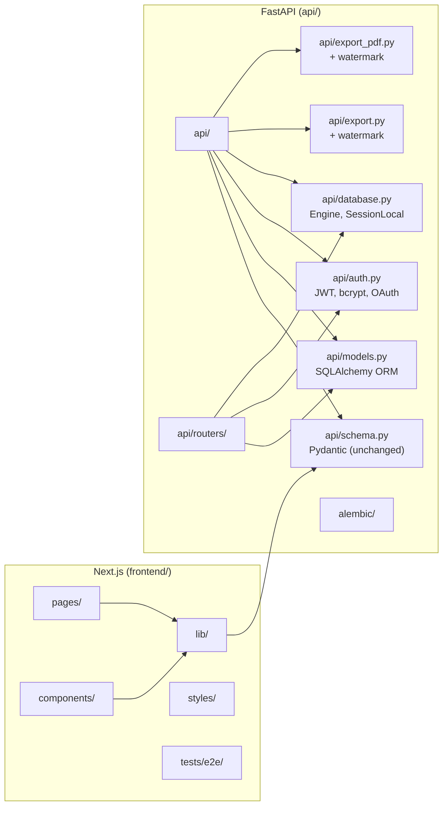
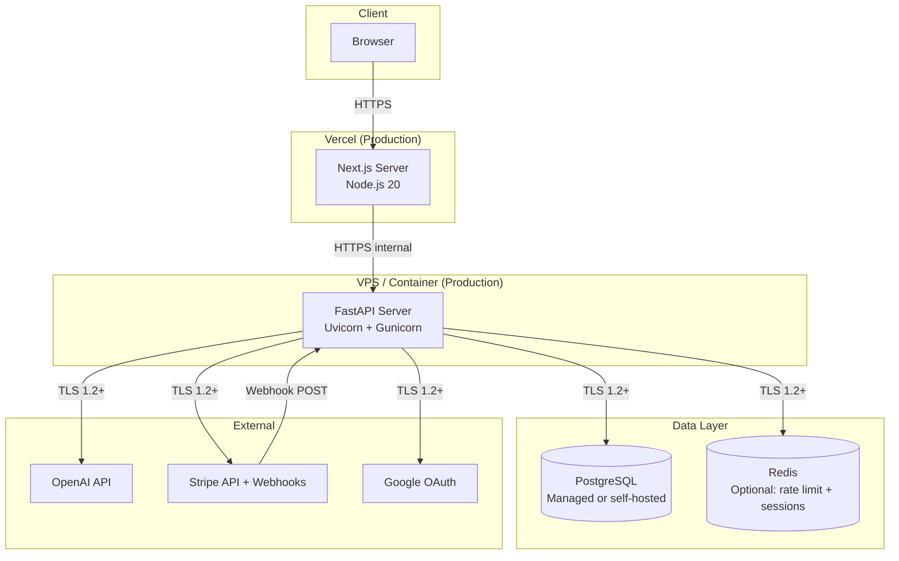
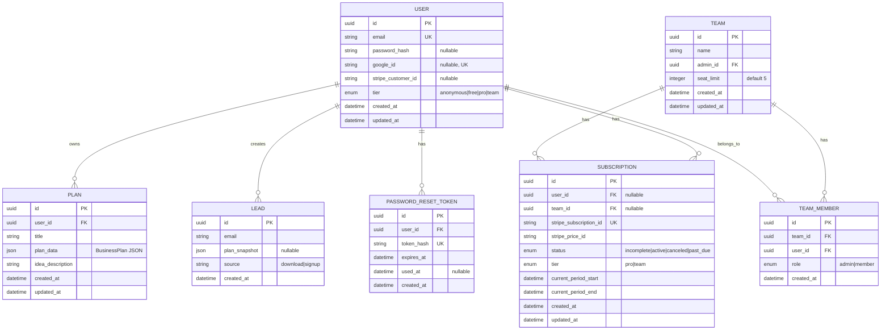

# Forge — SaaS Pivot Architecture

**Status:** Proposed  
**Date:** 2026-06-11  
**Author:** Solution Architect  
**Scope:** Pivot from free, no-persistence tool to monetized SaaS with tiered access, auth, persistence, and Stripe payments.

---

## Table of Contents

1. [Context & Stakeholders](#1-context--stakeholders)
2. [Requirements Traceability](#2-requirements-traceability)
3. [Quality-Attribute Scenarios](#3-quality-attribute-scenarios)
4. [4+1 Architectural Views](#4-41-architectural-views)
5. [Data Architecture](#5-data-architecture)
6. [Interfaces & Contracts](#6-interfaces--contracts)
7. [Threat Model (STRIDE)](#7-threat-model-stride)
8. [Tech Stack](#8-tech-stack)
9. [Trade-off Analysis (ATAM)](#9-trade-off-analysis-atam)
10. [Migration Plan](#10-migration-plan)
11. [Deliberately Out of Scope](#11-deliberately-out-of-scope)
12. [Appendix: ADR Index](#12-appendix-adr-index)

---

## 1. Context & Stakeholders

### 1.1 System Overview

Forge is an AI-assisted business plan generator. The pre-pivot architecture is a two-process system:

- **Next.js** (`:3000`) — UI layer, thin API proxies, sessionStorage-based session persistence
- **FastAPI** (`:8000`) — Orchestration layer: OpenAI calls, schema validation, .docx/.pdf export generation
- **OpenAI** (`gpt-4.1-mini`) — LLM provider via structured outputs

The SaaS pivot introduces:
- **User identity** (email/password + Google OAuth)
- **Plan persistence** (per-user stored plans)
- **Tiered access** (Anonymous → Free → Pro $19/mo → Team $49/mo)
- **Payment processing** (Stripe Checkout + Customer Portal)
- **Lead capture** (email gate before download)

### 1.2 Stakeholders & Concerns (ISO/IEC/IEEE 42010)

| Stakeholder | Concern | Quality Attribute |
|---|---|---|
| **Founder / End User** | Generate a plan quickly; save and revisit; download without friction | Usability, Performance |
| **Free Tier User** | Save up to 3 plans; understand upgrade value | Usability, Functional Suitability |
| **Pro Subscriber** | Unlimited plans, fast generation, clean exports | Performance, Functional Suitability |
| **Team Admin** | Manage seats, white-label exports, batch generate | Functional Suitability, Maintainability |
| **Product Manager** | Track conversion funnels; iterate on pricing | Maintainability, Portability |
| **Security Engineer** | Protect PII; secure auth; prevent fraud | Security, Reliability |
| **Developer** | Incremental deployability; clear contracts; minimal schema drift | Maintainability, Compatibility |
| **Operator** | Monitor health; scale DB; manage Stripe webhooks | Reliability, Scalability |

---

## 2. Requirements Traceability

### 2.1 Functional Requirements (FR-x)

Derived from `docs/PRD-saas-pivot.md` §4.1, §5, §12.

| ID | Requirement | Source |
|---|---|---|
| FR-1 | Anonymous users can generate a complete business plan without authentication | M10, US-A1 |
| FR-2 | Download (.docx / .pdf) is gated by mandatory email capture for anonymous users | M1, US-A2 |
| FR-3 | Email capture creates a lightweight lead record (email + timestamp + plan snapshot) | M1, AC-A2.5 |
| FR-4 | Free account creation via email + password or Google OAuth | M2, M8, US-F2 |
| FR-5 | Free accounts can save up to 3 plans; view them in "My plans" list | M3, US-F3 |
| FR-6 | Saved plans load into `/app` in `done` state with all sections, critiques, investor questions restored | M3, AC-F3.3 |
| FR-7 | Pro tier ($19/mo) unlocks unlimited plans, priority generation, watermark-free exports | M4, US-P3 |
| FR-8 | Free-tier exports include "Generated with Forge" footer watermark | M5, US-A2 |
| FR-9 | Team tier ($49/mo) includes up to 5 seats, white-label exports, batch generation | S1, US-T1 |
| FR-10 | Self-service password reset via email | S5, US-F2 |
| FR-11 | Stripe Checkout hosted flow for Pro/Team subscription | M4, S1, US-P2 |
| FR-12 | Stripe Customer Portal for subscription management (cancel, update) | S5, US-P4 |
| FR-13 | Subscription status sync via Stripe webhooks | US-P2, US-P4 |
| FR-14 | All existing functionality preserved: generation, critique, export, investor questions, regeneration, demo mode | M10 |

### 2.2 Non-Functional Requirements (NFR-x)

| ID | Requirement | Source |
|---|---|---|
| NFR-1 | **Security:** Passwords hashed with bcrypt (cost factor ≥ 12) | M8 |
| NFR-2 | **Security:** JWT signed with HS256, stored in httpOnly cookie, 7-day expiry | Resolved Q7 |
| NFR-3 | **Security:** Stripe webhook signatures validated with `stripe-python` | FR-13 |
| NFR-4 | **Performance:** Plan generation latency ≤ 45s for 10-section structured output (P95) | Existing baseline |
| NFR-5 | **Performance:** "My plans" list query ≤ 200ms (P95) | M3 |
| NFR-6 | **Reliability:** SSE wire format unchanged; existing client parser continues to work | Constraint |
| NFR-7 | **Scalability:** SQLite for dev, PostgreSQL for prod; schema must support both | M9 |
| NFR-8 | **Maintainability:** Single source of truth for schema (Pydantic → TypeScript) | Existing convention |
| NFR-9 | **Testability:** e2e tests can bypass auth gates via dev-only header | PRD resolved Q8 |
| NFR-10 | **Deployability:** Incremental rollout in 4 phases without breaking existing flow | PRD §7 |
| NFR-11 | **Privacy:** No PII logged in plaintext; email addresses encrypted at rest if possible | Security posture |
| NFR-12 | **Compliance:** GDPR cookie consent banner for analytics and auth cookies | PRD §9 Dependencies |

---

## 3. Quality-Attribute Scenarios

Driving scenarios derived from ADD / ISO/IEC 25010.

### 3.1 Performance

| ID | Scenario | Measure |
|---|---|---|
| QA-P1 | Anonymous user submits idea; first SSE `section_start` event arrives | ≤ 3s (P95) |
| QA-P2 | Full 10-section plan generation completes | ≤ 45s (P95) |
| QA-P3 | Logged-in user opens "My plans" page | ≤ 200ms (P95) |
| QA-P4 | Pro user gets higher rate-limit bucket than free user | 10/min vs 5/min |

### 3.2 Security

| ID | Scenario | Measure |
|---|---|---|
| QA-S1 | Attacker with stolen JWT cannot forge tokens | HS256 secret ≥ 256 bits |
| QA-S2 | Attacker with DB dump cannot read plaintext passwords | bcrypt hash irreversible |
| QA-S3 | Attacker sends forged Stripe webhook | Signature validation rejects |
| QA-S4 | XSS cannot steal auth token | httpOnly cookie; no localStorage token |

### 3.3 Reliability

| ID | Scenario | Measure |
|---|---|---|
| QA-R1 | FastAPI restart does not lose in-flight generation | Stateless; client reconnects |
| QA-R2 | Stripe webhook delivery failure retries | 24h retry window; idempotent handlers |
| QA-R3 | DB connection failure degrades gracefully | Anonymous generation still works |

### 3.4 Maintainability

| ID | Scenario | Measure |
|---|---|---|
| QA-M1 | Adding a new tier requires changes in ≤ 3 files | Tier config centralized |
| QA-M2 | Schema change propagates to TS types automatically | Manual mirror; documented |
| QA-M3 | New developer understands auth flow in ≤ 15 min | Documented in ARCHITECTURE.md |

### 3.5 Scalability

| ID | Scenario | Measure |
|---|---|---|
| QA-SC1 | 100 concurrent anonymous generations | Rate limiter + OpenAI quota |
| QA-SC2 | 10,000 registered users | PostgreSQL handles with connection pooling |

---

## 4. 4+1 Architectural Views

### 4.1 Logical View (Components & Responsibilities)

```mermaid
graph TB
    subgraph Browser
        UI[Next.js UI Layer]
        SS[sessionStorage<br/>Anonymous Session]
    end

    subgraph NextJS["Next.js (:3000)"]
        PROXY["API Proxy Routes<br/>(pages/api/*.ts)"]
        AUTH["Auth Helpers<br/>JWT cookie read/write"]
    end

    subgraph FastAPI["FastAPI (:8000)"]
        GEN["/api/generate<br/>SSE Streaming"]
        CRIT["/api/critique"]
        REGEN["/api/regenerate"]
        INV["/api/investor-questions"]
        EXP["/api/export<br/>Watermark conditional"]
        EXP_PDF["/api/export-pdf<br/>Watermark conditional"]
        AUTH_API["/api/auth/*<br/>Login/Signup/OAuth"]
        PLAN_API["/api/plans/*<br/>CRUD + List"]
        SUB_API["/api/subscriptions/*<br/>Status + Checkout"]
        STRIPE_WH["/api/webhooks/stripe<br/>Idempotent handler"]
        RATE["Rate Limiter<br/>slowapi (tier-aware)"]
        VAL["Pydantic Schema Validation"]
    end

    subgraph Data["Data Layer"]
        DB[(SQLite dev / PostgreSQL prod)]
        CACHE[(Optional: Redis<br/>Rate limit + Sessions)]
    end

    subgraph External["External Services"]
        OPENAI[OpenAI API]
        STRIPE[Stripe API]
        GOOGLE[Google OAuth 2.0]
    end

    UI -->|fetch /api/*| PROXY
    UI -->|read/write| SS
    PROXY -->|proxy + attach cookie| GEN
    PROXY -->|proxy + attach cookie| CRIT
    PROXY -->|proxy + attach cookie| REGEN
    PROXY -->|proxy + attach cookie| INV
    PROXY -->|proxy + attach cookie| EXP
    PROXY -->|proxy + attach cookie| EXP_PDF
    PROXY -->|proxy| AUTH_API
    PROXY -->|proxy + attach cookie| PLAN_API
    PROXY -->|proxy + attach cookie| SUB_API
    PROXY -->|proxy| STRIPE_WH

    GEN -->|structured outputs| OPENAI
    CRIT -->|structured outputs| OPENAI
    REGEN -->|structured outputs| OPENAI
    INV -->|structured outputs| OPENAI
    AUTH_API -->|verify token| GOOGLE
    SUB_API -->|create session| STRIPE
    STRIPE_WH -->|event delivery| STRIPE

    GEN --> VAL
    CRIT --> VAL
    REGEN --> VAL
    INV --> VAL
    EXP --> VAL
    EXP_PDF --> VAL

    AUTH_API --> DB
    PLAN_API --> DB
    SUB_API --> DB
    STRIPE_WH --> DB

    GEN --> RATE
    CRIT --> RATE
    REGEN --> RATE
    INV --> RATE
    EXP --> RATE
    EXP_PDF --> RATE
```



#### Component Responsibilities

| Component | Responsibility | Technology |
|---|---|---|
| **Next.js UI** | Render landing, app, demo, auth modals, "My plans", pricing. Manage client-side state (sessionStorage for anonymous, React state for auth). | Next.js 16.2.4, React 19, Tailwind v4, framer-motion v12 |
| **Next.js API Proxy** | Forward requests to FastAPI, attach `Cookie` header, handle CORS preflight in production. No business logic. | Next.js API Routes |
| **FastAPI Auth** | Register, login, OAuth callback, password reset. Issue JWT in httpOnly cookie. Validate JWT on every protected request. | FastAPI, `python-jose`, `bcrypt`, `authlib` |
| **FastAPI Plans** | CRUD for saved plans. Enforce plan count limits per tier. Serialize/deserialize `BusinessPlan` JSON. | FastAPI, SQLAlchemy |
| **FastAPI Subscriptions** | Create Stripe Checkout sessions. Return subscription status. Redirect to Customer Portal. | FastAPI, `stripe-python` |
| **FastAPI Webhooks** | Receive Stripe webhooks. Idempotently update subscription status in DB. Validate signatures. | FastAPI, `stripe-python` |
| **FastAPI Generate** | Unchanged orchestration: OpenAI structured outputs → SSE section events. Add tier-aware rate limits. | FastAPI, `openai>=1.40` |
| **FastAPI Export** | Conditionally append watermark footer based on user's subscription tier. | `python-docx`, `fpdf2` |
| **Rate Limiter** | `slowapi` with custom key function: `user_id` for authenticated, `ip` for anonymous. Tier-aware limits. | `slowapi` |
| **Database** | Users, plans, subscriptions, teams, leads, password reset tokens. SQLite dev / PostgreSQL prod. | SQLAlchemy 2.x, Alembic |

### 4.2 Process View (Runtime Behaviour)

#### 4.2.1 Anonymous Plan Generation (Unchanged Flow)



#### 4.2.2 Email Capture → Download (New Flow)



#### 4.2.3 Auth Flow (JWT httpOnly Cookie)

```mermaid
sequenceDiagram
    actor U as User
    participant UI as Next.js UI
    participant PROXY as Next.js Proxy
    participant AUTH as FastAPI /api/auth
    participant DB as Database
    participant GOOGLE as Google OAuth

    %% Email + Password Signup
    U->>UI: Fill signup form (email, password)
    UI->>PROXY: POST /api/auth/signup {email, password}
    PROXY->>AUTH: Proxy request
    AUTH->>AUTH: Validate password ≥ 8 chars
    AUTH->>AUTH: Hash password with bcrypt
    AUTH->>DB: INSERT user (email, password_hash)
    AUTH->>AUTH: Create JWT (sub=user.id, exp=7d)
    AUTH-->>PROXY: 200 + Set-Cookie: forge_session=<jwt>; HttpOnly; Secure; SameSite=Lax
    PROXY-->>UI: 200 + Set-Cookie (proxied)
    UI->>UI: Logged-in state = true

    %% Google OAuth
    U->>UI: Click "Sign up with Google"
    UI->>UI: Redirect to Google OAuth consent
    GOOGLE-->>UI: Authorization code
    UI->>PROXY: POST /api/auth/oauth/google {code}
    PROXY->>AUTH: Proxy request
    AUTH->>GOOGLE: Exchange code for tokens + userinfo
    GOOGLE-->>AUTH: {email, sub}
    AUTH->>DB: SELECT user by email
    alt User exists
        AUTH->>AUTH: Create JWT
    else New user
        AUTH->>DB: INSERT user (email, google_id)
        AUTH->>AUTH: Create JWT
    end
    AUTH-->>PROXY: 200 + Set-Cookie
    PROXY-->>UI: 200 + Set-Cookie

    %% Authenticated Request
    U->>UI: Click "My plans"
    UI->>PROXY: GET /api/plans (Cookie: forge_session=...)
    PROXY->>AUTH: Proxy with Cookie header
    AUTH->>AUTH: Decode & verify JWT
    AUTH->>DB: SELECT plans WHERE user_id = sub
    DB-->>AUTH: Plan list
    AUTH-->>PROXY: 200 {plans: [...]}
    PROXY-->>UI: 200
```

#### 4.2.4 Stripe Checkout → Subscription Activation



### 4.3 Development View (Module / Package Organisation)



#### File-Level Changes

| File | Change | Rationale |
|---|---|---|
| `api/models.py` | **New.** SQLAlchemy models: `User`, `Plan`, `Subscription`, `Team`, `TeamMember`, `Lead`, `PasswordResetToken` | Data persistence |
| `api/database.py` | **New.** `create_engine`, `SessionLocal`, `get_db()` dependency. SQLite dev / PostgreSQL prod via env var. | DB connection management |
| `api/auth.py` | **New.** `create_access_token`, `verify_password`, `get_current_user` dependency, Google OAuth flow. | Auth logic |
| `api/routers/auth.py` | **New.** `/api/auth/signup`, `/api/auth/login`, `/api/auth/oauth/google`, `/api/auth/me`, `/api/auth/password-reset`, `/api/auth/password-reset-confirm` | Auth endpoints |
| `api/routers/plans.py` | **New.** `/api/plans` (GET list, POST create, GET {id}, DELETE {id}) | Plan persistence |
| `api/routers/subscriptions.py` | **New.** `/api/subscriptions/status`, `/api/subscriptions/checkout`, `/api/subscriptions/portal` | Subscription management |
| `api/routers/leads.py` | **New.** `/api/leads` (POST create) | Lead capture |
| `api/routers/webhooks.py` | **New.** `/api/webhooks/stripe` | Stripe webhook handler |
| `api/index.py` | **Modified.** Register new routers. Add `get_current_user` optional dependency to existing routes for tier-aware rate limiting. | Integration point |
| `api/export.py` | **Modified.** Accept `tier` parameter; conditionally append watermark footer. | Tiered export |
| `api/export_pdf.py` | **Modified.** Accept `tier` parameter; conditionally append watermark footer. | Tiered export |
| `lib/schema/business-plan.ts` | **Modified.** Add `User`, `Subscription`, `Plan` types. | TypeScript contract |
| `components/forge-app.tsx` | **Modified.** Add auth state, email-capture modal, tier checks before download. | UX integration |
| `components/layout/Nav.tsx` | **Modified.** Add auth UI (login/signup buttons, avatar, "My plans" link). | Navigation |
| `pages/my-plans.tsx` | **New.** List view of saved plans. | Free tier value |
| `pages/app.tsx` | **Modified.** Load saved plan from query param. | Plan restoration |
| `tests/e2e/auth.spec.ts` | **New.** Auth flow tests with bypass flag. | Test coverage |
| `tests/e2e/tier.spec.ts` | **New.** Tier enforcement tests. | Test coverage |
| `requirements.txt` | **Modified.** Add `sqlalchemy`, `alembic`, `psycopg2-binary`, `python-jose[cryptography]`, `bcrypt`, `stripe`, `authlib`, `email-validator` | Dependencies |

### 4.4 Physical / Deployment View



#### Environment Topology

| Environment | Next.js | FastAPI | Database | Notes |
|---|---|---|---|---|
| **Local Dev** | `next dev` (:3000) | `uvicorn` (:8000) | SQLite (`forge.db`) | `npm run dev:all` starts both |
| **CI / Test** | `next build` + Playwright | `uvicorn` (:8000) | SQLite (`:memory:` or temp file) | `X-Test-Auth: bypass` header enabled |
| **Staging** | Vercel Preview | VPS / Container | PostgreSQL (staging) | Stripe test mode |
| **Production** | Vercel | VPS / Container | PostgreSQL (prod) | Stripe live mode, `Secure` cookies |

### 4.5 Scenarios View (+1) — Key Use Cases

#### Scenario 1: Anonymous User Generates and Downloads

1. User visits `/app`, types idea, clicks Generate
2. FastAPI `/api/generate` streams SSE sections (unchanged)
3. Plan renders in UI; sessionStorage persists
4. User clicks "Download .docx"
5. UI detects no auth cookie → shows email-capture modal
6. User submits email → POST `/api/leads` creates lead record
7. UI proceeds to POST `/api/export` with `tier: 'anonymous'`
8. FastAPI generates docx with "Generated with Forge" watermark
9. Browser triggers download

#### Scenario 2: Free User Saves and Hits Limit

1. User generates 1st plan, sees "Save your plan — create free account" banner
2. User clicks, signs up with email + password
3. FastAPI creates user, issues JWT cookie, auto-saves current plan
4. User visits "My plans", sees 1 saved plan
5. User generates 2nd plan, saves it (2/3)
6. User generates 3rd plan, saves it (3/3)
7. User generates 4th plan, clicks Save → UI shows upgrade CTA
8. FastAPI POST `/api/plans` returns 403 `{error: {code: "PLAN_LIMIT_REACHED", message: "Upgrade to Pro to save unlimited plans."}}`

#### Scenario 3: Pro User Checkout and Export

1. Free user clicks "Upgrade to Pro" on limit CTA
2. UI calls POST `/api/subscriptions/checkout` → receives Stripe Checkout URL
3. Redirect to Stripe, complete payment
4. Stripe webhook `checkout.session.completed` hits FastAPI
5. FastAPI updates subscription to `pro_active`
6. User redirected to `/app?success=1`
7. UI fetches `/api/subscriptions/status` → shows Pro badge
8. User downloads export → no watermark; rate limit = 10/min

---

## 5. Data Architecture

### 5.1 Entity-Relationship Diagram



### 5.2 SQLAlchemy Models (Python)

```python
# api/models.py — simplified representation
from sqlalchemy import Column, String, DateTime, ForeignKey, Integer, Enum, JSON, Text
from sqlalchemy.dialects.postgresql import UUID
from sqlalchemy.orm import declarative_base, relationship
import uuid
from datetime import datetime

Base = declarative_base()

class User(Base):
    __tablename__ = "users"
    id = Column(UUID(as_uuid=True), primary_key=True, default=uuid.uuid4)
    email = Column(String(255), unique=True, nullable=False, index=True)
    password_hash = Column(String(255), nullable=True)
    google_id = Column(String(255), unique=True, nullable=True, index=True)
    stripe_customer_id = Column(String(255), nullable=True, index=True)
    tier = Column(Enum("anonymous", "free", "pro", "team", name="user_tier"), default="free")
    created_at = Column(DateTime, default=datetime.utcnow)
    updated_at = Column(DateTime, default=datetime.utcnow, onupdate=datetime.utcnow)

    plans = relationship("Plan", back_populates="user", cascade="all, delete-orphan")
    subscriptions = relationship("Subscription", back_populates="user")
    team_memberships = relationship("TeamMember", back_populates="user")

class Plan(Base):
    __tablename__ = "plans"
    id = Column(UUID(as_uuid=True), primary_key=True, default=uuid.uuid4)
    user_id = Column(UUID(as_uuid=True), ForeignKey("users.id"), nullable=False, index=True)
    title = Column(String(255), nullable=False)
    plan_data = Column(JSON, nullable=False)
    idea_description = Column(Text, nullable=False)
    created_at = Column(DateTime, default=datetime.utcnow)
    updated_at = Column(DateTime, default=datetime.utcnow, onupdate=datetime.utcnow)

    user = relationship("User", back_populates="plans")

class Subscription(Base):
    __tablename__ = "subscriptions"
    id = Column(UUID(as_uuid=True), primary_key=True, default=uuid.uuid4)
    user_id = Column(UUID(as_uuid=True), ForeignKey("users.id"), nullable=True, index=True)
    team_id = Column(UUID(as_uuid=True), ForeignKey("teams.id"), nullable=True, index=True)
    stripe_subscription_id = Column(String(255), unique=True, nullable=False)
    stripe_price_id = Column(String(255), nullable=False)
    status = Column(Enum("incomplete", "active", "canceled", "past_due", name="sub_status"), default="incomplete")
    tier = Column(Enum("pro", "team", name="sub_tier"), nullable=False)
    current_period_start = Column(DateTime, nullable=True)
    current_period_end = Column(DateTime, nullable=True)
    created_at = Column(DateTime, default=datetime.utcnow)
    updated_at = Column(DateTime, default=datetime.utcnow, onupdate=datetime.utcnow)

    user = relationship("User", back_populates="subscriptions")
    team = relationship("Team", back_populates="subscriptions")

class Team(Base):
    __tablename__ = "teams"
    id = Column(UUID(as_uuid=True), primary_key=True, default=uuid.uuid4)
    name = Column(String(255), nullable=False)
    admin_id = Column(UUID(as_uuid=True), ForeignKey("users.id"), nullable=False)
    seat_limit = Column(Integer, default=5)
    created_at = Column(DateTime, default=datetime.utcnow)
    updated_at = Column(DateTime, default=datetime.utcnow, onupdate=datetime.utcnow)

    members = relationship("TeamMember", back_populates="team", cascade="all, delete-orphan")
    subscriptions = relationship("Subscription", back_populates="team")

class TeamMember(Base):
    __tablename__ = "team_members"
    id = Column(UUID(as_uuid=True), primary_key=True, default=uuid.uuid4)
    team_id = Column(UUID(as_uuid=True), ForeignKey("teams.id"), nullable=False, index=True)
    user_id = Column(UUID(as_uuid=True), ForeignKey("users.id"), nullable=False, index=True)
    role = Column(Enum("admin", "member", name="team_role"), default="member")
    created_at = Column(DateTime, default=datetime.utcnow)

    team = relationship("Team", back_populates="members")
    user = relationship("User", back_populates="team_memberships")

class Lead(Base):
    __tablename__ = "leads"
    id = Column(UUID(as_uuid=True), primary_key=True, default=uuid.uuid4)
    email = Column(String(255), nullable=False, index=True)
    plan_snapshot = Column(JSON, nullable=True)
    source = Column(Enum("download", "signup", name="lead_source"), default="download")
    created_at = Column(DateTime, default=datetime.utcnow)

class PasswordResetToken(Base):
    __tablename__ = "password_reset_tokens"
    id = Column(UUID(as_uuid=True), primary_key=True, default=uuid.uuid4)
    user_id = Column(UUID(as_uuid=True), ForeignKey("users.id"), nullable=False, index=True)
    token_hash = Column(String(255), unique=True, nullable=False, index=True)
    expires_at = Column(DateTime, nullable=False)
    used_at = Column(DateTime, nullable=True)
    created_at = Column(DateTime, default=datetime.utcnow)
```

### 5.3 Pydantic Schema Models (API Contracts)

```python
# api/schema.py — additions to existing schema
from pydantic import BaseModel, Field, EmailStr
from typing import Optional, List
from datetime import datetime

class UserBase(BaseModel):
    email: EmailStr

class UserSignupRequest(UserBase):
    password: str = Field(min_length=8)

class UserLoginRequest(UserBase):
    password: str

class UserResponse(BaseModel):
    id: str
    email: str
    tier: str
    created_at: datetime

class PlanCreateRequest(BaseModel):
    title: str = Field(min_length=1, max_length=255)
    plan_data: BusinessPlan
    idea_description: str

class PlanResponse(BaseModel):
    id: str
    title: str
    idea_description: str
    created_at: datetime
    updated_at: datetime

class PlanDetailResponse(PlanResponse):
    plan_data: BusinessPlan

class LeadCreateRequest(BaseModel):
    email: EmailStr
    plan_snapshot: Optional[dict] = None
    source: str = "download"

class SubscriptionStatusResponse(BaseModel):
    tier: str  # "free", "pro", "team"
    status: str  # "active", "canceled", "past_due", "none"
    current_period_end: Optional[datetime] = None

class CheckoutRequest(BaseModel):
    price_id: str
    tier: str  # "pro" or "team"

class CheckoutResponse(BaseModel):
    checkout_url: str

class PortalResponse(BaseModel):
    portal_url: str
```

### 5.4 Data Flows

| Flow | Data | Classification | Encryption |
|---|---|---|---|
| Browser → FastAPI (auth) | Email, password | **PII / Sensitive** | TLS 1.2+ in transit; bcrypt at rest |
| Browser → FastAPI (plan) | Business idea, generated plan | **Business-sensitive** | TLS 1.2+ in transit; stored as JSON in DB |
| FastAPI → OpenAI | Business idea, plan JSON | **Business-sensitive** | TLS 1.2+ in transit; OpenAI processes per their policy |
| FastAPI → Stripe | Customer email, subscription metadata | **PII / Financial** | TLS 1.2+ in transit; Stripe handles PCI compliance |
| Stripe → FastAPI (webhook) | Subscription status, customer ID | **Financial** | TLS 1.2+; signature validated |
| FastAPI → DB | All persisted data | **Mixed** | PostgreSQL SSL/TLS connection; SQLite file-level encryption not used (dev only) |

### 5.5 Data Residency & Retention

| Data Type | Residency | Retention Policy |
|---|---|---|
| User account | Primary DB | Until deletion request |
| Saved plans | Primary DB | Until user deletes or account deletion |
| Leads | Primary DB | 2 years, then anonymize email |
| Password reset tokens | Primary DB | 24 hours or until used |
| Subscription records | Primary DB | 7 years (tax/billing compliance) |
| Session cookies | Client browser | 7 days (JWT expiry) |
| Anonymous session | sessionStorage | Tab lifetime only |

### 5.6 PII Classification

| Field | PII Level | Protection |
|---|---|---|
| `users.email` | **Direct PII** | Unique index, never logged in plaintext, not exposed in APIs except to owner |
| `users.password_hash` | **Credential** | bcrypt with salt, not readable |
| `users.google_id` | **Indirect PII** | Unique index, not exposed in APIs |
| `users.stripe_customer_id` | **Financial PII** | Not exposed in APIs |
| `plans.plan_data` | **Business-sensitive** | Owned by user; not shared |
| `leads.email` | **Direct PII** | Same as `users.email` |

---

## 6. Interfaces & Contracts

### 6.1 Auth Cookie Contract

```
Name:     forge_session
Value:    <JWT>
Domain:   <production domain>
Path:     /
HttpOnly: true
Secure:   true (production) / false (dev)
SameSite: Lax
Max-Age:  604800 (7 days)
```

JWT Payload:
```json
{
  "sub": "<user_uuid>",
  "email": "<user_email>",
  "tier": "free|pro|team",
  "iat": 1718083200,
  "exp": 1718688000
}
```

### 6.2 API Endpoints — New

| Method | Path | Auth | Request | Response | Description |
|---|---|---|---|---|---|
| POST | `/api/auth/signup` | No | `{email, password}` | `UserResponse` + Set-Cookie | Email/password signup |
| POST | `/api/auth/login` | No | `{email, password}` | `UserResponse` + Set-Cookie | Email/password login |
| POST | `/api/auth/oauth/google` | No | `{code}` | `UserResponse` + Set-Cookie | Google OAuth callback |
| GET | `/api/auth/me` | Yes | — | `UserResponse` | Current user info |
| POST | `/api/auth/password-reset` | No | `{email}` | `{message}` | Request reset email |
| POST | `/api/auth/password-reset-confirm` | No | `{token, new_password}` | `UserResponse` + Set-Cookie | Confirm reset |
| GET | `/api/plans` | Yes | — | `PlanResponse[]` | List user's plans |
| POST | `/api/plans` | Yes | `PlanCreateRequest` | `PlanResponse` | Save a plan |
| GET | `/api/plans/{id}` | Yes | — | `PlanDetailResponse` | Load a plan |
| DELETE | `/api/plans/{id}` | Yes | — | `{deleted}` | Delete a plan |
| POST | `/api/leads` | No | `LeadCreateRequest` | `{lead_id}` | Capture lead email |
| GET | `/api/subscriptions/status` | Yes | — | `SubscriptionStatusResponse` | Current subscription |
| POST | `/api/subscriptions/checkout` | Yes | `CheckoutRequest` | `CheckoutResponse` | Start Stripe checkout |
| POST | `/api/subscriptions/portal` | Yes | — | `PortalResponse` | Stripe Customer Portal |
| POST | `/api/webhooks/stripe` | No (sig check) | Stripe payload | `200 OK` | Stripe events |

### 6.3 API Endpoints — Modified

| Method | Path | Change | Description |
|---|---|---|---|
| POST | `/api/generate` | Add optional `Authorization` header (cookie). Rate limit key = `user_id` if auth, else `ip`. | Tier-aware rate limiting |
| POST | `/api/critique` | Same as above. | Tier-aware rate limiting |
| POST | `/api/regenerate` | Same as above. | Tier-aware rate limiting |
| POST | `/api/investor-questions` | Same as above. | Tier-aware rate limiting |
| POST | `/api/export` | Accept `tier` in request body (or infer from auth). Conditionally add watermark. | Tiered export |
| POST | `/api/export-pdf` | Same as above. | Tiered export |

### 6.4 Request/Response Changes to Existing Endpoints

**`/api/export` (modified)**

Request body now accepts:
```json
{
  "plan": { /* BusinessPlan JSON */ },
  "tier": "anonymous"  // optional; inferred from auth if omitted
}
```

Response unchanged: `StreamingResponse` with `Content-Type: application/vnd.openxmlformats-officedocument.wordprocessingml.document`.

**`/api/generate` (modified — rate limit only)**

No request/response body changes. Rate limiter key function updated:
```python
def get_rate_limit_key(request: Request) -> str:
    user = getattr(request.state, "user", None)
    if user:
        return f"user:{user.id}"
    return get_remote_address(request)
```

---

## 7. Threat Model (STRIDE)

### 7.1 Trust Boundaries

1. **Browser ↔ Next.js** (Public internet)
2. **Next.js ↔ FastAPI** (Internal network / same host in dev; separate services in prod)
3. **FastAPI ↔ Database** (Internal network)
4. **FastAPI ↔ OpenAI** (External API)
5. **FastAPI ↔ Stripe** (External API + Webhooks)
6. **FastAPI ↔ Google OAuth** (External API)

### 7.2 STRIDE Analysis

#### Boundary: Browser → Next.js → FastAPI (Auth Flows)

| Asset / Flow | Threat Category | Threat Description | Impact | Mitigation |
|---|---|---|---|---|
| Login POST | Spoofing | Attacker brute-forces passwords | High | bcrypt slow hash; rate limit 5/min per IP |
| Login POST | Tampering | MITM intercepts credentials | High | TLS 1.2+ enforced; HSTS header |
| JWT Cookie | Information Disclosure | XSS steals token | High | **httpOnly cookie** (no localStorage); `SameSite=Lax` |
| JWT Cookie | Tampering | Attacker modifies token claims | Medium | HS256 signature verified server-side |
| JWT Secret | Information Disclosure | Secret leaked in source/repo | Critical | Secret from env var; ≥ 256 bits; rotated on breach |
| Password Reset | Spoofing | Attacker requests reset for victim | Medium | Token sent to registered email only; 24h expiry |
| Password Reset | Tampering | Attacker guesses reset token | Medium | Cryptographically random token; hashed in DB; single use |
| Signup | Repudiation | Attacker creates accounts with fake emails | Low | No email verification required (per PRD); monitor for abuse |
| OAuth Callback | Spoofing | Attacker sends forged OAuth code | Medium | Exchange code with Google server-side; verify `sub` |

#### Boundary: Browser → FastAPI (Plan Generation & Persistence)

| Asset / Flow | Threat Category | Threat Description | Impact | Mitigation |
|---|---|---|---|---|
| `/api/generate` | Denial of Service | Attacker floods generation endpoint | High | Rate limit 5/min (anon) / 10/min (pro); IP-based for anon |
| `/api/generate` | Elevation of Privilege | Free user claims Pro rate limit | Medium | JWT `tier` claim verified; not client-supplied |
| `/api/plans` | Information Disclosure | User A reads User B's plans | High | `WHERE user_id = current_user.id` enforced on every query |
| `/api/plans` | Tampering | User modifies another user's plan | High | Ownership check before UPDATE/DELETE |
| Plan JSON | Information Disclosure | Plan data leaked in logs | Medium | Never log full `plan_data`; log only `plan_id` |
| `/api/leads` | Denial of Service | Attacker spams lead creation | Low | Rate limit 10/min per IP; email format validation |

#### Boundary: FastAPI ↔ Stripe

| Asset / Flow | Threat Category | Threat Description | Impact | Mitigation |
|---|---|---|---|---|
| Webhook POST | Spoofing | Attacker sends fake Stripe event | Critical | **Stripe signature validation** with `stripe-python` `construct_event()` |
| Webhook POST | Tampering | MITM modifies webhook payload | Critical | TLS + signature validation |
| Webhook POST | Repudiation | Stripe retries; handler not idempotent | Medium | Idempotency: `UPDATE ... WHERE status != 'active'` |
| Checkout Session | Information Disclosure | Price IDs exposed to client | Low | Price IDs are public in Stripe; no secret leakage |
| Customer Portal | Elevation of Privilege | User A accesses User B's portal | Medium | Portal session created with `stripe_customer_id` from DB, not client |

#### Boundary: FastAPI ↔ Database

| Asset / Flow | Threat Category | Threat Description | Impact | Mitigation |
|---|---|---|---|---|
| DB Connection | Information Disclosure | Credentials leaked | Critical | Connection string from env var; not in source |
| DB Connection | Tampering | SQL injection | High | SQLAlchemy ORM (parameterized queries); no raw SQL concatenation |
| SQLite file | Information Disclosure | Dev DB file exposed | Medium | `.gitignore` `*.db`; file permissions 600 |
| PostgreSQL | Information Disclosure | Unencrypted connection | Medium | `sslmode=require` in connection string |

---

## 8. Tech Stack

### 8.1 Existing Stack (Verified from `package.json`, `requirements.txt`)

| Layer | Technology | Version | Verified |
|---|---|---|---|
| Frontend framework | Next.js | 16.2.4 | `package.json` |
| React | React / React DOM | 19.2.4 | `package.json` |
| Styling | Tailwind CSS | v4 | `package.json` |
| PostCSS | `@tailwindcss/postcss` | v4 | `package.json` |
| Animation | framer-motion | 12.38.0 | `package.json` |
| UI primitives | Radix UI Slot | 1.2.4 | `package.json` |
| Variants | class-variance-authority | 0.7.1 | `package.json` |
| Utilities | clsx, tailwind-merge | latest | `package.json` |
| Backend framework | FastAPI | latest | `requirements.txt` |
| Server | uvicorn[standard] | latest | `requirements.txt` |
| LLM client | openai | >=1.40 | `requirements.txt` |
| Schema | pydantic | >=2.0 | `requirements.txt` |
| Documents | python-docx | latest | `requirements.txt` |
| PDF | fpdf2 | latest | `requirements.txt` |
| Rate limiting | slowapi | latest | `requirements.txt` |
| Testing | Playwright | 1.60.0 | `package.json` |

### 8.2 New Dependencies (To Add)

| Layer | Technology | Version | Requirement Served | Verification Status |
|---|---|---|---|---|
| ORM | SQLAlchemy | 2.x | NFR-7 (SQLite/PostgreSQL); data persistence | To be added — verify on install |
| Migrations | Alembic | latest | NFR-7; schema evolution | To be added — verify on install |
| PostgreSQL driver | psycopg2-binary | latest | NFR-7 (production DB) | To be added — verify on install |
| JWT | python-jose[cryptography] | latest | NFR-2 (JWT signing/validation) | To be added — verify on install |
| Password hashing | bcrypt | latest | NFR-1 (secure password storage) | To be added — verify on install |
| Payments | stripe | latest | FR-11, FR-12, FR-13 | To be added — verify on install |
| OAuth | authlib | latest | FR-4 (Google OAuth) | To be added — verify on install |
| Email validation | email-validator | latest | FR-3 (lead capture validation) | To be added — verify on install |
| Environment | python-multipart | latest | FastAPI form data (OAuth callback) | To be added — verify on install |

### 8.3 Technology Choices — Justification

| Decision | Chosen | Rejected | Rationale |
|---|---|---|---|
| Auth token storage | **httpOnly cookie** | localStorage | QA-S4: XSS cannot steal httpOnly cookie. Simpler than localStorage + `Authorization` header on every request. |
| Password hashing | **bcrypt** | Argon2, PBKDF2 | NFR-1: bcrypt is battle-tested, widely supported in Python, sufficient for this threat model. Argon2 is better but adds dependency complexity. |
| JWT library | **python-jose** | PyJWT, jose-jwt | python-jose supports HS256/RS256 and is commonly used with FastAPI. PyJWT is also fine; either is acceptable. |
| OAuth library | **authlib** | social-auth-core | authlib is lightweight, integrates cleanly with Starlette/FastAPI, no Django dependency. |
| ORM | **SQLAlchemy 2.x** | Tortoise ORM, Prisma | SQLAlchemy is the standard in Python; supports both SQLite and PostgreSQL seamlessly; Alembic integration mature. |
| Migrations | **Alembic** | raw SQL, Django migrations | Alembic is the SQLAlchemy-native migration tool; industry standard. |
| Payment processor | **Stripe** | Paddle, PayPal | PRD resolved Q1: Stripe only. Best developer experience, hosted checkout, customer portal, robust webhooks. |
| Checkout type | **Stripe Checkout (hosted)** | Stripe Elements (embedded) | Hosted checkout reduces PCI scope (Stripe handles card fields), faster to implement, trusted UI. |
| Rate limiter enhancement | **slowapi (custom key func)** | redis-rate-limit, custom middleware | slowapi already in use; extending with tier-aware key function is minimal change. Redis adds infrastructure cost not justified at this scale. |
| Dev database | **SQLite** | PostgreSQL local Docker | SQLite requires zero setup for new developers; file-based; sufficient for dev/test. PostgreSQL reserved for prod/staging. |

---

## 9. Trade-off Analysis (ATAM)

### 9.1 Sensitivity Points

A sensitivity point is a component whose change significantly affects a quality attribute.

| ID | Sensitivity Point | Quality Attribute | Rationale |
|---|---|---|---|
| SP-1 | `slowapi` key function (IP vs user_id) | Performance, Security | Changing from IP-based to user-based rate limiting affects both fairness (Pro users get higher limits) and DoS resistance |
| SP-2 | JWT secret rotation | Security, Reliability | Rotating the secret invalidates all sessions; requires graceful handling |
| SP-3 | Watermark logic in export modules | Maintainability | Conditional footer logic in `python-docx`/`fpdf2` is scattered; centralized tier-check helper reduces drift |
| SP-4 | DB schema (Plan JSON storage) | Scalability, Maintainability | Storing plan as JSON blob is flexible but prevents SQL querying of plan content; acceptable since no search/filter by plan content is required |
| SP-5 | Stripe webhook idempotency | Reliability | Missing idempotency creates duplicate subscription records on retries |

### 9.2 Trade-off Points

A trade-off point is a decision where improving one quality attribute worsens another.

| ID | Decision | Improved | Worsened | Rationale |
|---|---|---|---|---|
| TP-1 | **httpOnly cookie vs localStorage** | Security (QA-S4) | Cross-domain complexity | httpOnly cookie cannot be read by JS, so Next.js cannot know auth state without a `/api/auth/me` call on every page load. Adds 1 round-trip. |
| TP-2 | **SQLite dev / PostgreSQL prod** | Developer experience | Compatibility risk | SQLite lacks some PostgreSQL features (JSONB ops, array types). Schema must stay simple and portable. |
| TP-3 | **Mandatory email capture vs friction** | Lead capture (business) | Conversion rate (QA-P1) | Mandatory email before download may cause drop-off. PRD assumption A11: <60% abandonment. |
| TP-4 | **Soft UI prompt + hard API cap** | User experience | Implementation complexity | Soft prompt reduces surprise; hard cap requires tier check on every save API call. Two enforcement layers. |
| TP-5 | **Stripe Checkout hosted vs embedded** | Security / PCI scope | Customization | Hosted checkout limits UI customization but eliminates PCI burden. |
| TP-6 | **No email verification** | Conversion (lower friction) | Security / deliverability | Unverified emails may bounce or be fake. Acceptable for lead capture; problematic for password reset. Mitigation: password reset only works if email is valid. |

### 9.3 Risks

| ID | Risk | Likelihood | Impact | Mitigation |
|---|---|---|---|---|
| R-1 | **Auth integration breaks sessionStorage flow** | Medium | High | Keep sessionStorage as anonymous fallback. `ForgeApp` state machine works with or without logged-in user. Phase 1 ships auth scaffolding without removing sessionStorage. |
| R-2 | **Stripe webhook signature validation misconfigured** | Medium | Critical | Test with Stripe CLI `stripe listen --forward-to localhost:8000/api/webhooks/stripe`. Log all webhook events in dev. |
| R-3 | **Rate-limiting logic fails to distinguish tiers** | Medium | Medium | Unit test `get_rate_limit_key` with authenticated and anonymous requests. Integration test with `slowapi` in-memory store. |
| R-4 | **e2e tests fail due to auth gates** | Medium | High | Implement `X-Test-Auth: bypass` header (dev-only). Create test fixture user in CI. Update Playwright tests to expect email modal on download. |
| R-5 | **DB schema migration fails in production** | Low | High | Use Alembic. Test migrations against PostgreSQL in CI. Freeze schema before Phase 3. |
| R-6 | **Next.js proxy fails to forward cookies in production** | Medium | High | Verify `fetch` in Next.js API routes forwards `Cookie` header. Test with `curl` against both dev rewrite and production proxy. |
| R-7 | **Team tier complexity delays Pro launch** | Medium | High | Defer Team tier to Phase 4. Build Pro first. Team tier can start as "contact us" (Calendly) before full multi-seat UI. |

### 9.4 Non-Risks

| ID | Non-Risk | Rationale |
|---|---|---|
| NR-1 | **OpenAI API cost increase from tiered users** | Pro pricing ($19/mo) covers ~50 plans at current gpt-4.1-mini pricing. Unlimited is a soft promise bounded by rate limits. |
| NR-2 | **Schema change breaks existing clients** | Schema is additive only. Existing `BusinessPlan` model unchanged. New auth/subscription models are separate. |
| NR-3 | **Mobile app required** | Explicitly out of scope (W4). Mobile web is sufficient. |
| NR-4 | **Real-time collaboration needed** | Explicitly out of scope (W1). Team tier is multi-seat consumption, not concurrent editing. |

---

## 10. Migration Plan

### 10.1 Phase 1: Foundation (Week 1)

**Goal:** Auth + DB scaffolding, email capture gate, watermark, preserve e2e tests.

| Step | Action | Files | Acceptance |
|---|---|---|---|
| 1.1 | Add SQLAlchemy, Alembic, python-jose, bcrypt, stripe, authlib to `requirements.txt` | `requirements.txt` | `pip install -r requirements.txt` succeeds |
| 1.2 | Create `api/database.py` with SQLite default, PostgreSQL via env | `api/database.py` | `get_db()` yields working session |
| 1.3 | Create `api/models.py` with `User`, `Plan`, `Lead` (minimal) | `api/models.py` | Alembic `revision --autogenerate` produces valid migration |
| 1.4 | Create `api/auth.py` with JWT create/verify, bcrypt helpers | `api/auth.py` | Unit tests for password hash + JWT round-trip |
| 1.5 | Create `api/routers/auth.py` with signup, login, me | `api/routers/auth.py` | `curl` signup → login → me works |
| 1.6 | Create `api/routers/leads.py` | `api/routers/leads.py` | POST creates lead record |
| 1.7 | Modify `api/export.py` and `api/export_pdf.py` to accept `tier` and conditionally watermark | `api/export.py`, `api/export_pdf.py` | Free tier has watermark; Pro/Team does not |
| 1.8 | Modify `api/index.py` to register new routers | `api/index.py` | All routes reachable via `/api/*` |
| 1.9 | Add Next.js auth state helpers (cookie read, `/api/auth/me` call) | `lib/auth.ts` (new) | Nav shows login/signup appropriately |
| 1.10 | Add email-capture modal to `ForgeApp` | `components/forge-app.tsx` | Download triggers modal for anonymous users |
| 1.11 | Update e2e tests: add `X-Test-Auth: bypass` support in FastAPI | `api/auth.py`, `tests/e2e/` | Existing tests pass; new auth tests pass |

**Critical constraint:** `sessionStorage` remains the anonymous fallback. No removal of existing flow.

### 10.2 Phase 2: Free Tier (Week 2)

**Goal:** Free account creation, plan persistence, "My plans" view, password reset.

| Step | Action | Files | Acceptance |
|---|---|---|---|
| 2.1 | Add `Plan` CRUD router | `api/routers/plans.py` | Auth'd user can create, list, get, delete plans |
| 2.2 | Add plan limit enforcement (3 plans for free tier) | `api/routers/plans.py` | 4th plan save returns 403 |
| 2.3 | Add Google OAuth flow | `api/routers/auth.py` | OAuth signup → login works |
| 2.4 | Create `pages/my-plans.tsx` | `pages/my-plans.tsx` | Lists plans, clickable to load |
| 2.5 | Modify `pages/app.tsx` to load plan from query param | `pages/app.tsx` | `?plan_id=xxx` loads saved plan |
| 2.6 | Add "Save plan" button to `ForgeApp` | `components/forge-app.tsx` | Saves current plan to DB |
| 2.7 | Add free-account prompt banner after 1st plan | `components/forge-app.tsx` | Banner appears, dismissible |
| 2.8 | Add password reset flow | `api/routers/auth.py`, email service | Self-service reset works |

### 10.3 Phase 3: Pro Tier (Week 3)

**Goal:** Pro upgrade prompt, Stripe checkout, subscription status, Pro benefits.

| Step | Action | Files | Acceptance |
|---|---|---|---|
| 3.1 | Add `Subscription` model and router | `api/models.py`, `api/routers/subscriptions.py` | Checkout session created |
| 3.2 | Add Stripe webhook handler | `api/routers/webhooks.py` | Webhook updates subscription status |
| 3.3 | Add upgrade CTA UI when free limit hit | `components/forge-app.tsx`, `pages/my-plans.tsx` | CTA visible, links to checkout |
| 3.4 | Add Pro badge and tier-aware UI | `components/layout/Nav.tsx` | Pro users see badge |
| 3.5 | Add Stripe Customer Portal link | `api/routers/subscriptions.py` | User can manage billing |
| 3.6 | Add tier-aware rate limits | `api/index.py` (limiter key func) | Pro users get 10/min |
| 3.7 | Add plan deletion for Pro users | `api/routers/plans.py` | DELETE works for owner |

### 10.4 Phase 4: Team Tier & Polish (Week 4+)

**Goal:** Team tier, distribution hooks, demo improvements, hero rewrite.

| Step | Action | Files | Acceptance |
|---|---|---|---|
| 4.1 | Add `Team` and `TeamMember` models | `api/models.py` | Schema supports teams |
| 4.2 | Add team admin invite flow | `api/routers/teams.py` | Admin invites by email |
| 4.3 | Add team seat enforcement | `api/routers/teams.py` | 6th member rejected |
| 4.4 | Add white-label export (no Forge branding) | `api/export.py`, `api/export_pdf.py` | Team exports have no header/footer |
| 4.5 | Add batch generation (up to 10 ideas) | `api/routers/batch.py` | Returns 10 plans |
| 4.6 | Landing page distribution hooks | `pages/index.tsx` | Coach/agency blocks visible |
| 4.7 | Demo improvements | `pages/demo.tsx`, `lib/fixtures/` | High-converting scenarios |

### 10.5 Rollback Strategy

| Phase | Rollback Trigger | Action |
|---|---|---|
| Phase 1 | Auth breaks existing flow | Revert `api/index.py` router registration; keep `sessionStorage` only |
| Phase 2 | DB performance issues | Add connection pooling (`sqlalchemy.pool`); consider read replica |
| Phase 3 | Stripe integration fails | Disable checkout CTA; allow free unlimited temporarily |
| Phase 4 | Team tier too complex | Ship as "contact us" (Calendly) instead of full multi-seat |

---

## 11. Deliberately Out of Scope

| Feature | Rationale | PRD Reference |
|---|---|---|
| Real-time collaboration / multi-user editing | Too complex; Team tier is consumption, not concurrent editing | W1 |
| Custom branding / domain white-label | Beyond Team tier v1; defer until validated demand | W2 |
| AI model selection by user | Adds complexity; gpt-4.1-mini for all tiers | W3 |
| Mobile native app | Web-first SaaS; mobile web sufficient | W4 |
| Advanced analytics dashboard for users | No validated demand; "My plans" list is sufficient | W5 |
| Affiliate / referral program | Defer until baseline monetization proven | W6 |
| Internationalization (i18n) | English-only for launch | W7 |
| Phone/SMS auth | Email + OAuth sufficient; SMS adds cost | W8 |
| Two-factor authentication (2FA) | Defer until security audit or enterprise tier | W9 |
| Plan sharing / public links | Adds moderation risk; defer | W10 |
| Redis for production caching | Not justified by current scale; add when rate-limit or session load requires | Assumption |
| Email service integration (SendGrid/Postmark/Resend) | Welcome email and password reset can use Python `smtplib` initially; upgrade to transactional provider when deliverability matters | PRD §9 Dependencies |

---

## 12. Appendix: ADR Index

Every significant architecture decision is recorded in `docs/adr/`:

| ADR | Title | Status |
|---|---|---|
| [ADR-001](adr/ADR-001-jwt-httponly-cookie.md) | JWT in httpOnly Cookie Session | Proposed |
| [ADR-002](adr/ADR-002-sqlite-postgresql-sqlalchemy.md) | SQLite Dev / PostgreSQL Prod with SQLAlchemy + Alembic | Proposed |
| [ADR-003](adr/ADR-003-stripe-checkout-hosted.md) | Stripe Checkout Hosted Flow | Proposed |
| [ADR-004](adr/ADR-004-fastapi-owns-auth.md) | FastAPI Owns Auth and Business Logic | Proposed |
| [ADR-005](adr/ADR-005-soft-prompt-hard-cap.md) | Soft UI Prompt + Hard API Cap for Tier Enforcement | Proposed |
| [ADR-006](adr/ADR-006-watermark-footer.md) | Watermark as Document Footer | Proposed |
| [ADR-007](adr/ADR-007-e2e-auth-bypass.md) | Dev-Only e2e Auth Bypass | Proposed |
| [ADR-008](adr/ADR-008-no-session-migration.md) | No Migration of Anonymous Session Plans on Signup | Proposed |

---

*End of Architecture Document. This is a living document. Update when assumptions are validated, open questions are resolved, or scope changes.*
